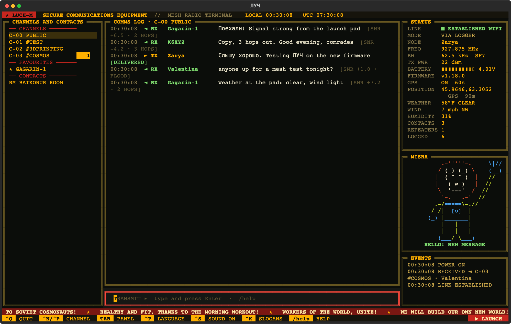
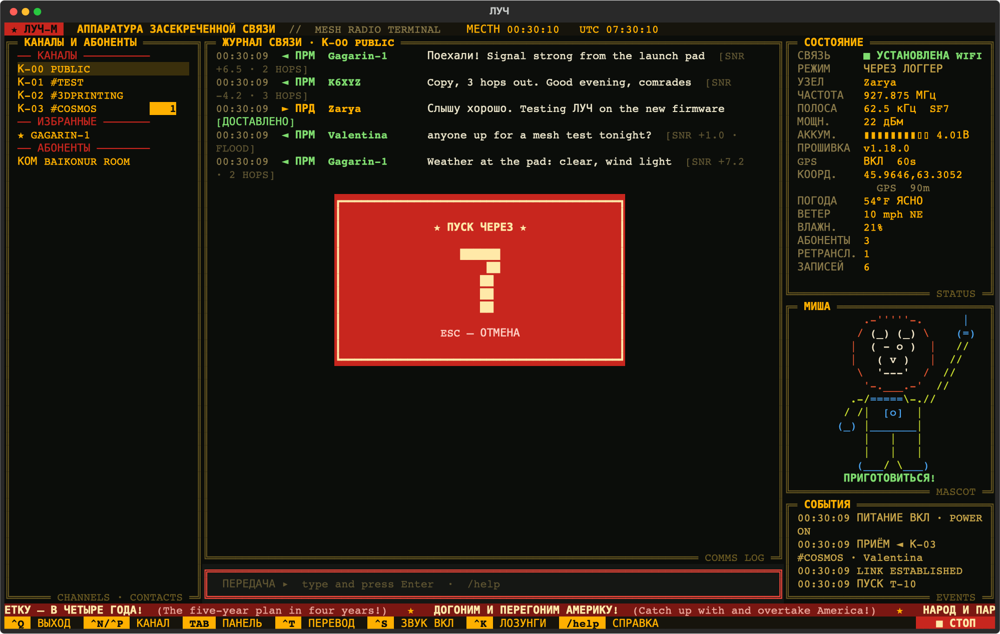

# ЛУЧ (LUCH)

Terminal client for a [MeshCore](https://github.com/meshcore-dev/MeshCore) Companion radio, styled like a Soviet comms console. Connects over Bluetooth, USB or Wi-Fi, and logs every message to SQLite. An optional background logger keeps the radio connected and logging while the screen is closed.

> [!TIP]
> **American comrade? Press `Ctrl+T`.** The screen is in Russian, and so is the label for the language switch (ПЕРЕВОД). `Ctrl+T` turns every heading, button and slogan into English ("Yankee mode"); press it again for Russian. LUCH remembers your choice, or start with `--english`. Messages are never translated.

**Website:** [mojeska.github.io/luch](https://mojeska.github.io/luch/), where Misha the cosmonaut explains everything (and the ПУСК button works).


<details>
<summary>Same screen in Yankee mode (Ctrl+T), and the launch countdown</summary>





</details>

Built on [meshcore_py](https://github.com/meshcore-dev/meshcore_py) and [Textual](https://github.com/Textualize/textual). Runs on macOS and Linux; see [Tested hardware](#tested-hardware) for what has actually been tried.

Screen text is Russian with English hints; **Ctrl+T** switches it all to English, see the tip above.

## Tested hardware

LUCH has been used with these radios, on a Mac (macOS, Apple silicon):

| Radio | Firmware | Bluetooth | Wi-Fi | USB | GPS |
| --- | --- | --- | --- | --- | --- |
| Heltec WiFi LoRa 32 **V3** (ESP32-S3) | MeshCore Companion BLE 1.17.1, 1.18.0 | ✅ | ✅ (1.18.0) | not tried | no GPS on board |
| Seeed **Wio Tracker L1 Pro** (nRF52840) | MeshCore Companion BLE 1.17.1, 1.18.0 | ✅ | not on this board | not tried | ✅ |

What that covers: messages on channels and DMs, the background logger (over Bluetooth and over Wi-Fi), channels, favourites, renaming a node, the firmware check, GPS position and weather. Firmware was updated on both with the steps in [Updating firmware](#updating-firmware).

**Not tested yet:**

- **Other boards.** LUCH talks to the radio through [meshcore_py](https://github.com/meshcore-dev/meshcore_py), the same protocol the MeshCore phone app uses, so any board running MeshCore **Companion** firmware should work. Repeater and room-server firmware won't. What a board offers (Wi-Fi, GPS, a screen, battery reporting) varies, and LUCH only shows what the radio reports.
- **USB.** The code is there (`--port`), but no USB Companion build has been tried. A board flashed with the BLE build does not answer over USB.
- **Linux with a real radio.** The automated tests run on Ubuntu, but Bluetooth, USB and the systemd logger haven't been used with hardware on Linux (Omarchy is next).
- **Firmware before 1.17.** `/cli`, Wi-Fi and `/name` need 1.18.

Tried LUCH on another radio? Please open an issue with the board, firmware version, and what worked, so it can go in this table.

## Updating firmware

LUCH tells you when a newer Companion release is out (`/firmware`). The [MeshCore web flasher](https://meshcore.io/flasher) is the easy way to update. What was done here, keeping contacts, channels and keys:

- **ESP32 boards (Heltec V3):** back up the whole flash with `esptool read-flash 0 0x800000 backup.bin`, then write only the app with `esptool write-flash 0x10000 <board>_companion_radio_ble-<ver>.bin` (not the `-merged` image). The Heltec's USB serial chip needed `--baud 115200`; faster speeds gave serial errors.
- **nRF52 boards (Wio Tracker L1):** double-press reset, and the board appears as a USB drive (`TRACKER L1`); copy the `.uf2` onto it. Save `CURRENT.UF2` from the drive first as a fallback.

## Install

Python 3.11 or later.

```sh
git clone https://github.com/mojeska/luch.git && cd luch
python3 -m venv .venv && .venv/bin/pip install -e .
```

## Run

Bluetooth, by BLE name (any part of it works).

```sh
.venv/bin/luch -d MeshCore-MyNode
```

USB, finding the port automatically (or give it, e.g. `--port /dev/cu.usbserial-0001`).

```sh
.venv/bin/luch --port auto
```

Wi-Fi (radio already on your network, TCP port 5000 by default).

```sh
.venv/bin/luch --tcp 192.168.1.50 --radio mynode
```

Browse the log without connecting.

```sh
.venv/bin/luch --offline
```

## Linux (Arch / Omarchy)

Bluetooth and USB access, then install as above.

```sh
sudo pacman -S --needed python bluez bluez-utils
sudo systemctl enable --now bluetooth
sudo usermod -aG uucp $USER     # USB serial (/dev/ttyUSB*, /dev/ttyACM*); log out and back in
```

The radio has to be paired once, with the 6-digit PIN shown on its screen. Pass it with `--pin` on the first Bluetooth connect and LUCH answers the pairing request itself (Linux usually has no program to ask you for it):

```sh
.venv/bin/luch -d MeshCore-MyNode --pin 123456
```

After that it's paired and `--pin` isn't needed. `luch service install -d MeshCore-MyNode --pin 123456` passes it to the logger too. On macOS, leave `--pin` off: the system asks for the PIN in a dialog.

Or pair by hand with `bluetoothctl`:

```sh
bluetoothctl
  scan on
  pair <radio address>
  trust <radio address>
```

On Debian / Ubuntu the serial group is `dialout` instead of `uucp`.

## Several radios

Each radio gets its own log, `~/.local/share/luch/<radio>.db`, named from `-d` (`MeshCore-MyNode` → `mynode`) or set with `--radio`. Use the same `--radio` name whichever way you connect to a radio, so Bluetooth and Wi-Fi sessions share one log. Plain `luch` connects to the running logger.

## Wi-Fi

Companion firmware 1.18+ on some boards runs Wi-Fi alongside Bluetooth. Tested on the Heltec V3; MeshCore's release notes also list the Heltec V4, Xiao S3, RAK3112 and others. This asks for the network and password (2.4 GHz), stores them on the radio and reboots it:

```sh
.venv/bin/luch wifi -d MeshCore-MyNode
```

Find its address with `/cli get wifi.ip` in LUCH (or your router; a DHCP reservation keeps it fixed), then move the logger to Wi-Fi so Bluetooth is free for the phone app:

```sh
.venv/bin/luch service install --radio mynode --tcp 192.168.1.50
```

The phone and the logger can then be connected at once. Messages the radio queued while nobody was connected go to whichever client asks first.

## GPS and weather

On a radio with GPS (tested on the Wio Tracker L1 Pro; MeshCore also builds GPS support for the T1000-E, Heltec Wireless Tracker and others), `/gps on 60` turns it on with a fix every 60 seconds, and the status panel shows the position. Without a fix, LUCH uses the position stored on the radio, then a home position you set with `/home <lat> <lon>`. Current weather for that position comes from [Open-Meteo](https://open-meteo.com) (no key needed), refreshed every 15 minutes or when you move about 1 km. `/units metric` switches from °F and mph.

Turning GPS on doesn't share your position: the radio only puts it in its adverts when its location policy says so.

## Background logger

On macOS it runs as a launchd agent, on Linux as a systemd user service: starts at login, restarts if it stops, and owns the radio. `luch` then connects to the logger instead of the radio, so the log has no gaps. Status shows РЕЖИМ ЧЕРЕЗ ЛОГГЕР (via logger).

```sh
.venv/bin/luch service install -d MeshCore-MyNode   # or: --port auto
.venv/bin/luch service status
.venv/bin/luch service stop        # frees the radio for the phone app
.venv/bin/luch service start
.venv/bin/luch service uninstall
```

Logger output: `~/.local/share/luch/logger.log` on macOS, `journalctl --user -u luch -f` on Linux. To keep the Linux service running while logged out: `loginctl enable-linger $USER`.

### From another computer

The logger can run on the machine the radio is attached to, with the screen on a different one. Forward the logger's socket over ssh, from the computer you'll read on:

```sh
ssh -N -L ~/.local/share/luch/mynode.sock:/home/you/.local/share/luch/mynode.sock radio-host
```

The right-hand path is on the logger's machine. Use the full path, since `~` isn't expanded there; on macOS it starts with `/Users/you`. Then run plain `luch`: it finds the forwarded socket like a local one.

The logger's SQLite file isn't on this computer, so the screen keeps its own copy, `~/.local/share/luch/mynode@<logger host>.db`. It catches up on everything it missed each time it connects. Read marks and tags are kept in that copy, separate from the logger's. Both machines need this version of LUCH.

Two ssh options help. Without them, a tunnel that ended badly leaves a socket file behind and the next `ssh -L` fails with "Address already in use", or ssh stays running with no forward. Add them to `~/.ssh/config`:

```
Host radio-host
  StreamLocalBindUnlink yes   # replace a leftover socket file
  ExitOnForwardFailure yes    # quit if the forward can't be set up
```

## Keys and commands

| | |
| --- | --- |
| Enter | Transmit on the selected channel or contact |
| `/dm <name>` | Open a direct line to a contact |
| `/search <words>` | Search every logged message |
| `/join #name` | Join a hashtag channel (the key comes from the name) |
| `/join <name> <key>` | Join a private channel (key: 32 hex characters or base64) |
| `/leave [#name]` | Leave a channel (default: the one on screen; Public stays) |
| `/fav [name]` / `/unfav [name]` | Favourite a contact on the radio (default: the one on screen) |
| `/tag <name> <tag>` / `/untag <name> <tag>` | Tag a contact (stored in LUCH only) |
| `/tags [tag]` | List tags, or the contacts carrying one |
| `/gps on\|off [secs]` | Radio GPS on or off, with an optional fix interval |
| `/home [<lat> <lon>]` | Show or set the home position for weather (`/home clear`) |
| `/weather` | Weather details for the current position |
| `/units metric\|imperial` | Units for weather |
| `/cli <command>` | Run a radio CLI command (firmware 1.18+), e.g. `/cli get wifi.ip` |
| `/name <new name>` | Rename the node and announce it (Bluetooth name changes after `/reboot`) |
| `/reboot` | Restart the radio; LUCH reconnects |
| `/firmware` | Radio firmware vs the newest MeshCore Companion release |
| **Ctrl+T** | **Yankee mode:** Russian / English screen text |
| Ctrl+B | Show / hide Misha |
| Ctrl+S, `/mute`, `/unmute` | Sound effects off / on (remembered) |
| Ctrl+K, `/ticker` | Slogan ticker on / off (remembered) |
| ▶ ПУСК button or Ctrl+L | 10-second countdown banner, then the anthem in 8-bit; ■ СТОП, Esc or `/stop` aborts or ends it |
| `/help` | Command list |
| Tab / Shift+Tab | Move between panels |
| Ctrl+N / Ctrl+P | Next / previous conversation |
| Ctrl+Q | Quit |

## Notes

- **One link at a time.** The radio takes one Bluetooth connection. Stop the logger (`luch service stop`) or close `luch` before using the phone app.
- **USB needs USB firmware.** MeshCore Companion builds have one interface: a BLE build won't answer over USB. Flash the USB Companion build to use `--port`.
- **Log:** `~/.local/share/luch/<radio>.db` (`--db` to change). Table `messages`, one row per message, duplicates ignored.
- **Queue:** with nothing connected, the radio keeps a small queue of messages, pulled in on the next connect. Overflow is lost.
- **Sidebar:** channels, then ★ favourites, then room servers and contacts with logged traffic or tags. Repeaters and sensors are left out. `/dm` reaches anyone else.
- **Favourites** use the radio's own flag, so the phone app sees them too, and the radio never drops a favourite when its contact list fills up. **Tags** live only in LUCH's database.
- **Misha (МИША):** a cosmonaut bear in the status column who reacts to the radio: waves at new messages, points up when a DM is delivered, and clutches his helmet when the link drops or the battery runs low (СЛАБОЕ ЗАЖИГАНИЕ, "weak ignition"). An homage to the diagnostic-screen mascot in *Red Planet* (2000), drawn from scratch.
- **Ticker:** historical Soviet slogans (posters, Lenin, the Internationale) and Ukrainian ones (Слава Україні!, in yellow) scroll along the bottom, with English translations, or English only in English mode.
- **Sound:** 8-bit effects for received messages (a different chirp for DMs), sent and delivered, and the link going up or down; at most one every 0.4 s so a burst doesn't chatter. The ▶ ПУСК (launch) button in the lower right plays the State Anthem (music by A. V. Alexandrov, 1939, public domain) in LUCH's own chiptune arrangement, with Misha saluting; it plays even when effects are muted. Everything is synthesised in Python on first run and cached as WAV files in the data directory; playback uses `afplay` on macOS or `paplay` / `pw-play` / `aplay` on Linux. `LUCH_SOUND=off` disables sound entirely.
- **Firmware check:** on connect, LUCH compares the radio's firmware with the newest Companion release on GitHub (cached 6 hours) and shows ▲ NEW in the status panel when there's an update. Update with the [MeshCore web flasher](https://meshcore.io/flasher).
- **Delivery:** DMs show ДОСТАВЛЕНО (delivered) on ACK, НЕТ ПОДТВ. (no ack) after the timeout.
- `--direct` talks to the radio even when the logger runs. `--debug` writes `luch.log` next to the database.

## Screenshots

Made from demo data (callsigns and a GPS fix at Baikonur), never your own log:

```sh
LUCH_SOUND=off .venv/bin/python tools/screenshots.py docs/   # writes SVGs; convert to PNG as you like
```

## Tests

```sh
.venv/bin/pip install pytest pytest-asyncio && .venv/bin/python -m pytest -q
```

## License

MIT. See [LICENSE](LICENSE).
