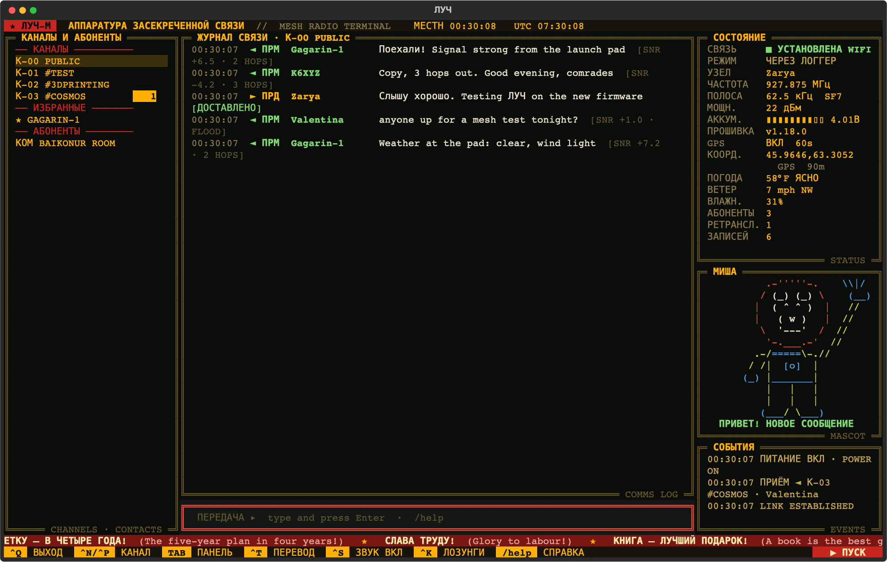

# ЛУЧ (LUCH)

Terminal client for a [MeshCore](https://github.com/meshcore-dev/MeshCore) Companion radio, styled like a Soviet comms console. Connects over Bluetooth, USB or Wi-Fi, and logs every message to SQLite. An optional background logger keeps the radio connected and logging while the screen is closed.



Built on [meshcore_py](https://github.com/meshcore-dev/meshcore_py) and [Textual](https://github.com/Textualize/textual). Runs on macOS and Linux. Tested on macOS with a Heltec V3.

Screen text is Russian with English hints; **Ctrl+T** switches it all to English (remembered between runs, or start with `--english`). Messages are never translated.

## Install

Python 3.11 or later.

```sh
git clone https://github.com/mojeska/luch.git && cd luch
python3 -m venv .venv && .venv/bin/pip install -e .
```

## Run

Bluetooth, by BLE name (any part of it works).

```sh
.venv/bin/luch -d MeshCore-MyNode
```

USB, finding the port automatically (or give it, e.g. `--port /dev/cu.usbserial-0001`).

```sh
.venv/bin/luch --port auto
```

Wi-Fi (radio already on your network, TCP port 5000 by default).

```sh
.venv/bin/luch --tcp 192.168.1.50 --radio mynode
```

Browse the log without connecting.

```sh
.venv/bin/luch --offline
```

## Linux (Arch / Omarchy)

Bluetooth and USB access, then install as above.

```sh
sudo pacman -S --needed python bluez bluez-utils
sudo systemctl enable --now bluetooth
sudo usermod -aG uucp $USER     # USB serial (/dev/ttyUSB*, /dev/ttyACM*); log out and back in
```

Pair the radio once before the first Bluetooth connect (it asks for the PIN shown on the radio's screen).

```sh
bluetoothctl
  scan on
  pair <radio address>
  trust <radio address>
```

On Debian / Ubuntu the serial group is `dialout` instead of `uucp`.

## Several radios

Each radio gets its own log, `~/.local/share/luch/<radio>.db`, named from `-d` (`MeshCore-MyNode` → `mynode`) or set with `--radio`. Use the same `--radio` name whichever way you connect to a radio, so Bluetooth and Wi-Fi sessions share one log. Plain `luch` connects to the running logger.

## Wi-Fi

Companion firmware 1.18+ on some boards (Heltec V3, V4, Xiao S3, RAK3112 and others) runs Wi-Fi alongside Bluetooth. This asks for the network and password (2.4 GHz), stores them on the radio and reboots it:

```sh
.venv/bin/luch wifi -d MeshCore-MyNode
```

Find its address with `/cli get wifi.ip` in LUCH (or your router; a DHCP reservation keeps it fixed), then move the logger to Wi-Fi so Bluetooth is free for the phone app:

```sh
.venv/bin/luch service install --radio mynode --tcp 192.168.1.50
```

The phone and the logger can then be connected at once. Messages the radio queued while nobody was connected go to whichever client asks first.

## GPS and weather

On a radio with GPS (Wio Tracker L1, T1000-E, Heltec Wireless Tracker and others), `/gps on 60` turns it on with a fix every 60 seconds, and the status panel shows the position. Without a fix, LUCH uses the position stored on the radio, then a home position you set with `/home <lat> <lon>`. Current weather for that position comes from [Open-Meteo](https://open-meteo.com) (no key needed), refreshed every 15 minutes or when you move about 1 km. `/units metric` switches from °F and mph.

Turning GPS on doesn't share your position: the radio only puts it in its adverts when its location policy says so.

## Background logger

On macOS it runs as a launchd agent, on Linux as a systemd user service: starts at login, restarts if it stops, and owns the radio. `luch` then connects to the logger instead of the radio, so the log has no gaps. Status shows РЕЖИМ ЧЕРЕЗ ЛОГГЕР (via logger).

```sh
.venv/bin/luch service install -d MeshCore-MyNode   # or: --port auto
.venv/bin/luch service status
.venv/bin/luch service stop        # frees the radio for the phone app
.venv/bin/luch service start
.venv/bin/luch service uninstall
```

Logger output: `~/.local/share/luch/logger.log` on macOS, `journalctl --user -u luch -f` on Linux. To keep the Linux service running while logged out: `loginctl enable-linger $USER`.

## Keys and commands

| | |
| --- | --- |
| Enter | Transmit on the selected channel or contact |
| `/dm <name>` | Open a direct line to a contact |
| `/search <words>` | Search every logged message |
| `/join #name` | Join a hashtag channel (the key comes from the name) |
| `/join <name> <key>` | Join a private channel (key: 32 hex characters or base64) |
| `/leave [#name]` | Leave a channel (default: the one on screen; Public stays) |
| `/fav [name]` / `/unfav [name]` | Favourite a contact on the radio (default: the one on screen) |
| `/tag <name> <tag>` / `/untag <name> <tag>` | Tag a contact (stored in LUCH only) |
| `/tags [tag]` | List tags, or the contacts carrying one |
| `/gps on\|off [secs]` | Radio GPS on or off, with an optional fix interval |
| `/home <lat> <lon>` | Home position for weather (`/home clear`) |
| `/weather` | Weather details for the current position |
| `/units metric\|imperial` | Units for weather |
| `/cli <command>` | Run a radio CLI command (firmware 1.18+), e.g. `/cli get wifi.ip` |
| `/name <new name>` | Rename the node and announce it (Bluetooth name changes after `/reboot`) |
| `/reboot` | Restart the radio; LUCH reconnects |
| `/firmware` | Radio firmware vs the newest MeshCore Companion release |
| Ctrl+T | Russian / English screen text |
| Ctrl+B | Show / hide Misha |
| `/help` | Command list |
| Tab / Shift+Tab | Move between panels |
| Ctrl+N / Ctrl+P | Next / previous conversation |
| Ctrl+Q | Quit |

## Notes

- **One link at a time.** The radio takes one Bluetooth connection. Stop the logger (`luch service stop`) or close `luch` before using the phone app.
- **USB needs USB firmware.** MeshCore Companion builds have one interface: a BLE build won't answer over USB. Flash the USB Companion build to use `--port`.
- **Log:** `~/.local/share/luch/<radio>.db` (`--db` to change). Table `messages`, one row per message, duplicates ignored.
- **Queue:** with nothing connected, the radio keeps a small queue of messages, pulled in on the next connect. Overflow is lost.
- **Sidebar:** channels, then ★ favourites, then room servers and contacts with logged traffic or tags. Repeaters and sensors are left out. `/dm` reaches anyone else.
- **Favourites** use the radio's own flag, so the phone app sees them too, and the radio never drops a favourite when its contact list fills up. **Tags** live only in LUCH's database.
- **Misha (МИША):** a cosmonaut bear in the status column who reacts to the radio: waves at new messages, points up when a DM is delivered, and clutches his helmet when the link drops or the battery runs low (СЛАБОЕ ЗАЖИГАНИЕ, "weak ignition"). An homage to the diagnostic-screen mascot in *Red Planet* (2000), drawn from scratch.
- **Firmware check:** on connect, LUCH compares the radio's firmware with the newest Companion release on GitHub (cached 6 hours) and shows ▲ NEW in the status panel when there's an update. Update with the [MeshCore web flasher](https://meshcore.io/flasher).
- **Delivery:** DMs show ДОСТАВЛЕНО (delivered) on ACK, НЕТ ПОДТВ. (no ack) after the timeout.
- `--direct` talks to the radio even when the logger runs. `--debug` writes `luch.log` next to the database.

## Tests

```sh
.venv/bin/pip install pytest pytest-asyncio && .venv/bin/python -m pytest -q
```

## License

MIT. See [LICENSE](LICENSE).
